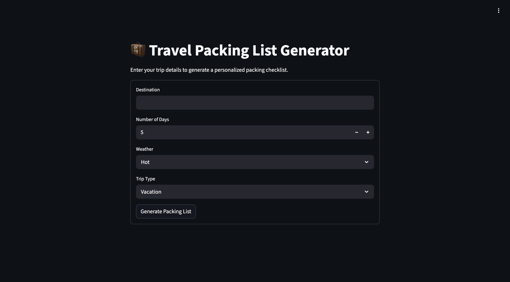

# 🧳 Travel Packing List Generator

An interactive **Travel Packing List Web Application** built using **Python and Streamlit**.

The application generates personalized packing checklists based on trip duration, manually selected weather conditions, trip type, and destination.

Users can select or deselect packing items, track their packing progress, and download their customized packing lists in TXT and PDF formats.

---

# 🚀 Live Demo

Try the application online without installing anything.

**Live Website:**  
https://travel-packing-list.onrender.com/

# 📸 Application Preview



---

# 🔥 Features

- 🧳 Personalized packing suggestions based on trip details.
- 🌦 Weather-based recommendations (Hot / Cold / Rainy).
- 📍 Destination-based suggestions for supported destinations.
- 🎒 Different recommendations for Vacation, Business, and Adventure trips.
- 📅 Packing quantities based on trip duration.
- 📋 Organized packing checklist with four categories:
  - Essentials
  - Clothing
  - Trip Gear
  - Daily Clothing
- ✅ Interactive checkboxes to select or deselect items.
- 📊 Packing progress bar to track completion.
- 📄 Download selected packing items as TXT files.
- 📕 Export selected packing items as PDF files.
- 🌐 Deployed online using Render.

**Note:** Weather recommendations currently depend on the weather condition selected by the user.

---

# 🧰 Technologies Used

- Python 3
- Streamlit
- FPDF
- Render (Deployment)

---

# ▶️ How to Run This Project

## 1. Run the Live Demo

Open the deployed application:

https://travel-packing-list.onrender.com/

No installation required.

## 2. Clone the Repository

Clone the project using Git:

```bash
git clone https://github.com/Majji-Rohit/travel-packing-list.git
```

Move into the project directory:

```bash
cd travel-packing-list
```

Create a virtual environment:

```bash
python3 -m venv .venv
```

Activate the virtual environment on macOS/Linux:

```bash
source .venv/bin/activate
```

Install the required dependencies:

```bash
python -m pip install -r requirements.txt
```

Run the application:

```bash
python -m streamlit run app.py
```

Open the application in your browser:

```text
http://localhost:8501
```

## 3. Download ZIP and Run

1. Open the GitHub repository.
2. Click **Code → Download ZIP**.
3. Extract the downloaded ZIP file.
4. Open the extracted folder in VS Code or Terminal.
5. Follow the virtual environment and installation steps above.
6. Run the application.

---

# 📂 Project Structure

```text
travel-packing-list/
│
├── app.py
├── requirements.txt
├── README.md
└── screenshot.png
```

---

# 📌 Future Improvements

- Integrate a weather API for automatic weather detection.
- Save previously generated packing lists.
- Improve the mobile user interface.
- Add more destination-specific recommendations.

---

# 📃 License

Free to use for personal and educational purposes.